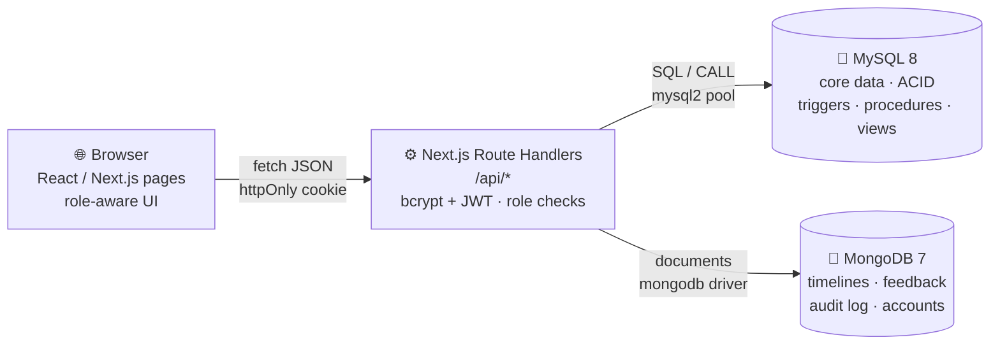

<div align="center">

# 🏠 PG Accommodation Management System

### Run every PG, room and resident from one place.

Allocations · Rent · Complaints · Visitors · Meals — **MySQL** for transactions, **MongoDB** for timelines, feedback and audit trails.


*DBMS Experiential Learning – Level 3 Project · PES University, Dept. of CSE · Instructor: Dr. Nagasundari S*

</div>

<p align="center">
  
  
</p>

---

## 📑 Table of contents
[Why this project](#-why-this-project) · [Features](#-features) · [Architecture](#-architecture) · [Quick start](#-quick-start) · [Demo accounts](#-demo-accounts) · [Database highlights](#-database-highlights) · [Screenshots](#-screenshots) · [Project structure](#-project-structure) · [Testing](#-testing) · [Troubleshooting](#-troubleshooting) · [Team](#-team)

---

## 💡 Why this project
Paying-guest businesses still run on notebooks and spreadsheets. Owners lose track of free beds, unpaid rent, pending complaints and expiring licences, and residents cannot see their dues or raise issues. Double-booked beds and forgotten rent turn into lost revenue and disputes.

This system gives owners, staff and residents one place to manage all of it — and enforces the important rules **inside the database**, so they hold no matter which client calls it.

## ✨ Features

| | |
|---|---|
| 🛏️ **Bed allocation** | Allocate, transfer, check out or cancel — every action is an atomic MySQL transaction that can never double-book a bed |
| 💳 **Rent & payments** | One-click monthly rent generation (idempotent), mark paid, live dues and overdue tracking |
| 🛠️ **Complaints** | Residents file complaints; staff change status/priority, reply and keep internal notes. Full-text search. Timeline stored in MongoDB |
| 🚪 **Visitor register** | Check-in / check-out, linked to residents, with history |
| 🍽️ **Meal menus** | Weekly menus and dishes; residents rate meals (1–5 stars + tags); averages via MongoDB aggregation |
| 📊 **Dashboards & reports** | Occupancy, revenue, complaints by priority, licence alerts, rent by room type, dues above average |
| 🔐 **Role-based access** | Admin, Staff and Resident roles with server-side checks on every API route |
| 🧾 **Audit log** | Every sign-in and data change recorded as a flexible document in MongoDB |

### 👥 Roles

| Role | Can do |
|---|---|
| **Admin** | Everything — including salaries, deletes and the audit log |
| **Staff** | Daily operations: allocations, payments, complaints, visitors, menus |
| **Resident** | Own profile, stay, payments, complaints, visitors and menus; rate meals |

## 🧭 Architecture



**Why two databases?** Strictly structured, relational data that needs integrity and transactions lives in **MySQL**. Append-only, write-heavy or variable-shape data lives in **MongoDB**. MongoDB documents reference MySQL rows by business key (for example `complaintNo`), and an automated test checks that every reference resolves.

## 🚀 Quick start

**Prerequisites:** Node.js 20.12+ · MySQL 8.0.16+ · MongoDB 6+ (both running locally)

```bash
git clone https://github.com/Amrutha-dev25/PG_MANAGEMENT_SYSTEM.git
cd PG_MANAGEMENT_SYSTEM

npm install
cp .env.example .env          # Windows: copy .env.example .env  → then edit the values

# generate a secret for AUTH_SECRET
node -e "console.log(require('crypto').randomBytes(32).toString('hex'))"

npm run db:setup              # creates MySQL schema + data AND MongoDB collections + data
npm run check                 # verifies .env, MySQL, MongoDB and demo accounts
npm run dev                   # → http://localhost:3000
```

> ⚠️ `npm run db:setup` **drops and recreates** both databases (`pg_management`, `pg_management_nosql`). Use `npm run db:mysql` / `npm run db:mongo` to run one side only.
>
> If MySQL says *"You do not have the SUPER privilege and binary logging is enabled"*, run once as root: `SET GLOBAL log_bin_trust_function_creators = 1;`

**Production build:** `npm run build && npm start`

### 🔑 Demo accounts
Seeded into MongoDB as bcrypt hashes. On the login page you can click **Admin / Staff / Resident** to fill them in.

| Role | Username | Password |
|---|---|---|
| Admin | `admin` | `Admin@123` |
| Staff | `staff` | `Staff@123` |
| Resident | `aarav` (also `diya`, `neha`) | `Resident@123` |

Change them with `SEED_*_PASSWORD` in `.env` before seeding.

### 📝 Creating a new account
The login page has a **Create account** option:

- **Resident** – enter a Resident ID that already exists in the `RESIDENT` table
- **Staff** – enter an existing Staff ID and the `STAFF_SIGNUP_CODE` from `.env`
- **Admin** – enter a name and the `ADMIN_SIGNUP_CODE` from `.env`

Choose private values for both codes in `.env`. Usernames are unique, passwords are bcrypt-hashed, and a new user is signed in immediately.

## 🗄️ Database highlights

| MySQL 8 (relational core) | MongoDB 7 (document store) |
|---|---|
| **23 tables** matching the ER diagram and relational schema | **4 collections**: `app_users`, `complaint_updates`, `meal_feedback`, `audit_logs` |
| **CHECK / regex constraints** for enums, phone, e-mail, pincode, dates, amounts | **JSON-Schema validators** on every collection |
| **15 triggers** – no double booking, bed status, supervisor rules, immutable settled payments | **Unique, compound, sparse and text indexes** |
| **5 transactional stored procedures** – allocate, transfer, close, generate rent, settle | **Aggregation pipelines** – ratings per meal, top tags, audit by role |
| **9 views**, **3 functions** – derived age, total due, occupancy % | Timeline read as one ordered list, no joins |
| **13 indexes + FULLTEXT** on complaints | One review per resident per meal (unique index) |

Derived attributes (resident **age**, payment **total due**) are *not stored* — they come from functions and views.

## 🌳 Project structure

```
pg-management-system/
├── database/
│   ├── mysql/            01_schema → 08_seed, plus 09–11 viva demos
│   ├── mongodb/          setup.mjs (validators, indexes, seed) · queries.mongosh.js
│   └── schema-spec.json  relational schema used by the conformance test
├── src/
│   ├── app/
│   │   ├── (app)/        protected pages (dashboard, residents, allocations, …)
│   │   ├── api/          REST route handlers (auth, allocations, payments, complaints, …)
│   │   └── login/        sign-in and create account
│   ├── components/       ResourcePage, FormFields, charts, views/ (workflow screens)
│   └── lib/              db, auth, crud engine, resources metadata, audit, http helpers
├── scripts/              setup-mysql · setup-mongo · check-setup · gen-data-dictionary
├── tests/                automated tests (npm test)
└── docs/                 report, documentation, diagrams, data dictionary, screenshots
```

## 🧪 Testing

```bash
npm test             # needs MySQL + MongoDB running and set up
npm run typecheck
npm run check        # environment check before a demo
```

The tests verify that the live schema matches the relational schema (tables, columns, PKs, FKs), that triggers and constraints reject bad data, that failed transactions roll back, that MySQL ↔ MongoDB references are consistent, that every sidebar link has a page, that every API route checks the session, and that no credentials are hard-coded.

## 🩺 Troubleshooting

| Message | Fix |
|---|---|
| *Database is not reachable* | Start MySQL and MongoDB, then run `npm run check` |
| *MySQL refused the login* | Fix `MYSQL_USER` / `MYSQL_PASSWORD` in `.env` and restart |
| *Database not found / table missing* | Run `npm run db:setup` once |
| *404 – action not found* | Stop the app, run `npm install`, then `npm run dev` |

A step-by-step demo script is in [`DEMO_GUIDE.md`](DEMO_GUIDE.md).

## 👩‍💻 Team

| Name | SRN | Focus |
|---|---|---|
| **Amrutha Kattimani** | PES1UG24CS054 | Frontend, documentation, MySQL |
| **Samhitha Alluru** | PES1UG24CS050 | MongoDB, backend & authentication, testing |

**Course instructor:** Dr. Nagasundari S · PES University, Department of Computer Science and Engineering

## 🔮 Future enhancements
Vector / semantic search over complaints · online payments with receipts · e-mail/SMS reminders for overdue rent and expiring licences · document file uploads · mobile app · multi-tenant owners · Redis-based rate limiting

---

<div align="center">

⭐ If you found this project useful, consider giving the repository a star.

</div>